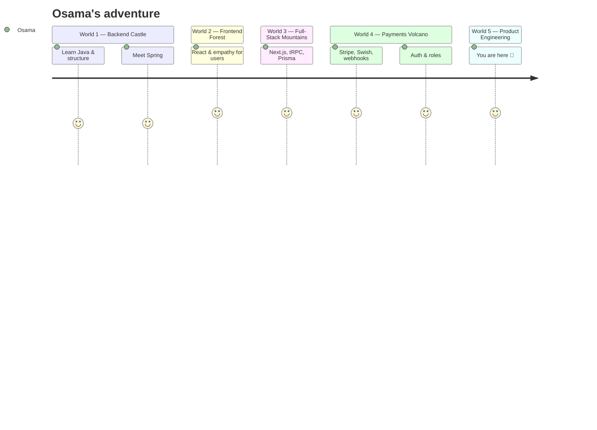

<div align="center">


<a href="https://git.io/typing-svg">
  
</a>

<br/>


</div>

---

## 🎮 Player Card

<div align="center">

```
╔══════════════════════════════════════════════════════════════╗
║  PLAYER 1 ........ Osama Khalili                             ║
║  CLASS ........... Full-Stack Developer                      ║
║  REALM ........... Sweden 🇸🇪   (UTC+1/+2, powered by fika ☕) ║
║  ORIGIN STORY .... Java backend → TypeScript → Product Eng.  ║
║  QUEST ........... Driving-school platforms, commerce        ║
║                    systems & school management tools         ║
║  MOTTO ........... "Ship it, measure it, improve it."        ║
╚══════════════════════════════════════════════════════════════╝
```

</div>

<table align="center">
<tr>
<td align="center">❤️ <b>HP</b><br/>Fika-fuelled</td>
<td align="center">⚡ <b>MP</b><br/>TypeScript</td>
<td align="center">🛡️ <b>DEF</b><br/>Type-safe APIs</td>
<td align="center">⚔️ <b>ATK</b><br/>Ships fast</td>
<td align="center">🌍 <b>LANG</b><br/>SV · AR · EN · SO</td>
</tr>
</table>

---

## 🗺️ World Map — The Path So Far



> 💡 Backend taught me structure. Frontend taught me empathy for the user. Shipping taught me that done is better than perfect.

---

## 🌳 Skill Tree

<div align="center">

<table>
<tr><td>

```
⚔️  LANGUAGES
 ├─ TypeScript ████████████░░  LV.9
 ├─ JavaScript ████████████░░  LV.9
 ├─ Java       █████████░░░░░  LV.7
 └─ HTML/CSS   ███████████░░░  LV.8

🧩  FRAMEWORKS
 ├─ Next.js · React · Node.js
 ├─ Spring · Vite · Tailwind
 └─ React Router 7

🗄️  DATA
 └─ PostgreSQL · MySQL · SQLite · Redis · Prisma · Drizzle

💳  PAYMENTS & AUTH
 └─ Stripe · Swish · Auth.js · Better Auth · JWT · Argon2id

🔍  INFRA & SEARCH
 └─ Meilisearch · Sentry · Vercel Cron · AWS S3

🧪  TESTING & TOOLS
 └─ Vitest · Playwright · Git · Docker · Linux
```

</td></tr>
</table>

<br/>
<br/><br/>


</div>

---

## 🕹️ Game Select — Projects I've Built

> Most of my recent work is private or client work, so these are case studies rather than public repositories. Pick a cartridge. 👇

<table>
<tr>
<td width="50%" valign="top">

### 💿 LEVEL 01 · Xtrafikskola
`🚗 Driving School` · Difficulty ⭐⭐⭐⭐⭐

From first lesson to licence: courses, calendar booking, evaluations, receipts and reports.

<details>
<summary><b>▶ Power-ups</b></summary>

- Student, instructor and admin dashboards
- STR progress tracking (15 moments)
- Stripe + Swish payments with idempotent webhooks
- SSE notifications, PWA, Swedish/Arabic (RTL)
- Vitest + Playwright test suites
</details>

`Next.js 16` `React 19` `tRPC` `Prisma` `PostgreSQL`

</td>
<td width="50%" valign="top">

### 💿 LEVEL 02 · Gbg Halkbana
`🗓️ Booking Platform` · Difficulty ⭐⭐⭐⭐

From public course pages to check-in at the venue, for driving schools and partner schools.

<details>
<summary><b>▶ Power-ups</b></summary>

- Public booking portal + Risk 1 / Risk 2 pages
- Admin, instructor and partner-school portals
- QR check-in, PDF invoices, self-service rescheduling
- Stripe + Swish + school invoicing
- Vercel Cron reminders and monthly invoicing
</details>

`Next.js` `tRPC` `Prisma` `Auth.js` `Stripe`

</td>
</tr>
<tr>
<td width="50%" valign="top">

### 💿 LEVEL 03 · Nexus Commerce
`🛍️ E-commerce` · Difficulty ⭐⭐⭐⭐⭐

Multilingual store with customer, vendor and admin experiences in one system.

<details>
<summary><b>▶ Power-ups</b></summary>

- 36 Prisma models across catalog, orders, vendors and CMS
- Stripe checkout, gift cards and PDF invoices
- Better Auth with OAuth + OTP
- Meilisearch, inventory alerts and review moderation
- Arabic/English content with 2,000+ translations
</details>

`Next.js 15` `TypeScript` `PostgreSQL` `tRPC`

</td>
<td width="50%" valign="top">

### 💿 LEVEL 04 · Alhuda Center
`📖 School Management` · Difficulty ⭐⭐⭐⭐

Quran school system: students, teachers, Halaka scheduling, attendance, progress and finance.

<details>
<summary><b>▶ Power-ups</b></summary>

- Admin, teacher and parent portals
- Quran/Nourania progress and homework evaluation
- Halaka scheduling and attendance tracking
- Payments, terms and educational-year reporting
- Self-issued JWT + Argon2id, S3 uploads
</details>

`React Router 7` `MySQL` `Drizzle` `Tailwind`

</td>
</tr>
</table>

### 🎁 Bonus Levels

<table>
<tr>
<td width="50%" valign="top">

#### 🔓 TeoriExporter Pro
`📤 Chrome Extension (MV3)`

Turns Swedish driving-theory content (TeoriCentralen, Körkortsboken, Trafiko) into clean, portable study material.

<details>
<summary><b>▶ Power-ups</b></summary>

- Markdown/JSON export with images
- Background crawl mode across chapters
- Reading themes, search and progress UI
- 120 KB content script, zero backend
</details>

`Chrome MV3` `JavaScript` `Data extraction`

</td>
<td width="50%" valign="top">

#### 🔓 Theory Question Bank
`📚 Data & Content`

Swedish driving-licence theory across taxi, bus, truck and professional competence categories.

<details>
<summary><b>▶ Power-ups</b></summary>

- 4,651 questions · 15 datasets · 112 quizzes
- Swedish and Arabic variants, shared schema
- 1,853 image and 2,508 audio references
- Encoding, duplicate and broken-media cleanup
</details>

`JSON` `Data modelling` `Content pipeline`

</td>
</tr>
<tr>
<td width="50%" valign="top">

#### 🔓 Video Library Server
`🎬 Self-hosted Streaming`

A classroom-LAN streaming server for a driving-school video library.

<details>
<summary><b>▶ Power-ups</b></summary>

- HMAC-signed streaming URLs, 12-hour expiry
- HTTP Range support for seeking
- Catalog auto-refresh every 30 seconds
- 272 videos across 6 languages
- Built-in question pages (150 Arabic / 210 Swedish)
</details>

`Node.js` `HTTP` `Streaming`

</td>
<td width="50%" valign="top">

#### 🔓 xTrafik & xTruck
`🌐 SEO Landing Sites`

Landing sites for a driving school and a truck-training programme in Gothenburg.

<details>
<summary><b>▶ Power-ups</b></summary>

- Hand-built static HTML with structured metadata
- Sitemap, robots.txt and 404 pages
- Apache `.htaccess` routing and caching
- Swedish, English and Arabic targeting
</details>

`HTML` `CSS` `SEO` `Apache`

</td>
</tr>
</table>

---

## 🏆 Quest Log

- [x] 🏗️ **Platform Builder** — 4 production-grade platforms, from database to UI
- [x] 💳 **Payments Engineer** — Stripe + Swish, webhooks, invoices and QR check-in
- [x] 📊 **Data Engineer** — 4,651-question bilingual exam bank
- [x] 🤖 **Automation Wizard** — Chrome crawler, CI pipelines, cron jobs, signed media URLs
- [x] 🌍 **Polyglot** — Swedish, Arabic (RTL), English and Somali
- [ ] 🔒 **???** — *collaborate with me to unlock this one*

---

## 📡 Telemetry

<div align="center">
  
  
</div>

<div align="center">
  
</div>

<div align="center">
  
</div>

<div align="center">
  <picture>
    <source media="(prefers-color-scheme: dark)" srcset="https://raw.githubusercontent.com/osamakhalili/osamakhalili/output/github-snake-dark.svg" />
    <source media="(prefers-color-scheme: light)" srcset="https://raw.githubusercontent.com/osamakhalili/osamakhalili/output/github-snake.svg" />
    
  </picture>
</div>

---

## 👾 Boss Fight: The Type Alchemist

> A traveler hands you the scroll `"Hello World"` and demands `"dlroW olleH"` — **in a single TypeScript type.** Choose your weapon.

<details>
<summary><b>⚔️ Round 1 — The Recursive Mage</b></summary>

```ts
type Reverse<S extends string> =
  S extends `${infer Head}${infer Tail}` ? `${Reverse<Tail>}${Head}` : "";
```
Template literal types + recursion. Elegant, and the compiler does the work.
</details>

<details>
<summary><b>🛡️ Round 2 — The Accumulator</b></summary>

```ts
type Reverse<S extends string, Acc extends string = ""> =
  S extends `${infer Head}${infer Tail}` ? Reverse<Tail, `${Head}${Acc}`> : Acc;
```
Tail-recursive form: each character is pushed onto the front of the accumulator.
</details>

<details>
<summary><b>💀 Final Round — The Tuple Weaver</b></summary>

```ts
type Split<S extends string> =
  S extends `${infer Head}${infer Tail}` ? [Head, ...Split<Tail>] : [];

type Join<T extends string[]> =
  T extends [infer Head extends string, ...infer Tail extends string[]]
    ? `${Head}${Join<Tail>}`
    : "";

type ReverseTuple<T extends string[]> =
  T extends [infer Head extends string, ...infer Tail extends string[]]
    ? [...ReverseTuple<Tail>, Head]
    : [];

type Reverse<S extends string> = Join<ReverseTuple<Split<S>>>;
```
Split into a tuple, reverse the tuple, join it back. Type-level composition at its finest.
</details>

**Found a weirder spell?** Open an issue or PR. The most creative one gets added here with credit. ✨

---

## 🌙 Pause Menu — When I'm Offline

<div align="center">

| 🛠️ Build mode | 📚 Learn mode | ☕ Fika mode |
|:---:|:---:|:---:|
| Side projects and refactoring | Deep dives into new stacks | Coffee, code reviews and good conversations |

</div>

---

## 🪙 Insert Coin to Collaborate

<div align="center">

```
   ╔═══════════════════════════════╗
   ║   🎮  CONTINUE?   9 8 7 ...   ║
   ║                               ║
   ║   ▶ YES — let's build         ║
   ║     something together        ║
   ╚═══════════════════════════════╝
```

[](https://github.com/osamakhalili)

<br/>


<br/>

**`// Building products that people actually use`**


</div>
