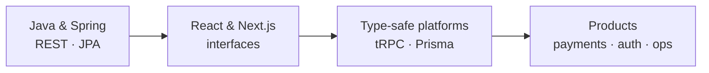

<!-- ============================== HERO ============================== -->
<div align="center">

<picture>
  <source media="(prefers-color-scheme: dark)" srcset="https://raw.githubusercontent.com/osamakhalili/osamakhalili/main/assets/hero-dark.svg" />
  <source media="(prefers-color-scheme: light)" srcset="https://raw.githubusercontent.com/osamakhalili/osamakhalili/main/assets/hero-light.svg" />
  
</picture>

<br/>


<br/><br/>

<a href="#user-content-work">Work</a> &nbsp;·&nbsp;
<a href="#user-content-toolbox">Toolbox</a> &nbsp;·&nbsp;
<a href="#user-content-journey">Journey</a> &nbsp;·&nbsp;
<a href="#user-content-telemetry">Stats</a> &nbsp;·&nbsp;
<a href="#user-content-connect">Connect</a>

</div>

<!-- ============================== INTRO ============================== -->
<br/>

<p align="center">
  I turn messy operational workflows into calm, type-safe web products.<br/>
  <sub>Driving schools &nbsp;·&nbsp; commerce &nbsp;·&nbsp; education &nbsp;·&nbsp; media</sub>
</p>

<div align="center">
  <picture>
    <source media="(prefers-color-scheme: dark)" srcset="https://raw.githubusercontent.com/osamakhalili/osamakhalili/main/assets/stats-dark.svg" />
    <source media="(prefers-color-scheme: light)" srcset="https://raw.githubusercontent.com/osamakhalili/osamakhalili/main/assets/stats-light.svg" />
    
  </picture>
</div>

<!-- ============================== WORK ============================== -->
<div align="center">
  
</div>

<a name="work"></a>

<div align="center">
  <sub><b>01 · SELECTED WORK</b></sub>
  <h2>Four platforms, four different problems</h2>
  <p><sub>Recent product work is private or client-owned, so these are case studies rather than public repositories.</sub></p>
</div>

<table>
<tr>
<td width="50%" valign="top">

<p align="center">
  
</p>

<h3 align="center">Xtrafikskola</h3>
<p align="center"><sub>DRIVING-SCHOOL OPERATIONS</sub></p>

The full journey from first lesson to licence — courses, booking, evaluations, payments and reporting in one platform.

- Student, instructor and admin dashboards
- STR progress tracking across 15 moments
- Stripe + Swish with idempotent webhooks
- PWA, SSE notifications, Swedish/Arabic RTL
- Vitest + Playwright test suites

<p align="center">
  <code>Next.js 16</code> <code>React 19</code> <code>tRPC</code> <code>Prisma</code> <code>PostgreSQL</code>
</p>

</td>
<td width="50%" valign="top">

<p align="center">
  
</p>

<h3 align="center">Gbg Halkbana</h3>
<p align="center"><sub>BOOKING &amp; CHECK-IN</sub></p>

A booking platform for driving schools and partner schools, from public course pages to QR check-in at the venue.

- Public portal + Risk 1 / Risk 2 pages
- Admin, instructor and partner-school portals
- QR check-in, PDF invoices, self-service rescheduling
- Stripe + Swish + school invoicing
- Vercel Cron reminders and monthly invoicing

<p align="center">
  <code>Next.js</code> <code>tRPC</code> <code>Prisma</code> <code>Auth.js</code> <code>Stripe</code>
</p>

</td>
</tr>
<tr>
<td width="50%" valign="top">

<p align="center">
  
</p>

<h3 align="center">Nexus Commerce</h3>
<p align="center"><sub>MULTILINGUAL COMMERCE</sub></p>

Customer, vendor and admin experiences in one system — catalog, orders, payments and content in two languages.

- 36 Prisma models across catalog, orders and CMS
- Stripe checkout, gift cards and PDF invoices
- Better Auth with OAuth + OTP
- Meilisearch, inventory alerts, review moderation
- Arabic/English content with 2,000+ translations

<p align="center">
  <code>Next.js 15</code> <code>TypeScript</code> <code>tRPC</code> <code>PostgreSQL</code>
</p>

</td>
<td width="50%" valign="top">

<p align="center">
  
</p>

<h3 align="center">Alhuda Center</h3>
<p align="center"><sub>QURAN SCHOOL MANAGEMENT</sub></p>

Students, teachers, Halaka scheduling, attendance, progress and finance for a Quran school — with three distinct portals.

- Admin, teacher and parent portals
- Quran/Nourania progress and homework evaluation
- Halaka scheduling and attendance tracking
- Payments, terms and educational-year reporting
- Self-issued JWT + Argon2id, S3 uploads

<p align="center">
  <code>React Router 7</code> <code>MySQL</code> <code>Drizzle</code> <code>Tailwind</code>
</p>

</td>
</tr>
</table>

<br/>

<div align="center">
  <sub><b>ALSO BUILT</b></sub>
</div>

<table>
<tr>
<td width="50%" valign="top">

<p> &nbsp;<b>TeoriExporter Pro</b></p>

A Chrome extension that turns Swedish driving-theory content into clean, portable study material. Works with TeoriCentralen, Körkortsboken and Trafiko; Markdown/JSON export, background crawl mode and reading themes.

<sub><code>Chrome MV3</code> <code>JavaScript</code> <code>Data extraction</code></sub>

</td>
<td width="50%" valign="top">

<p> &nbsp;<b>Theory Question Bank</b></p>

A structured, bilingual question bank for Swedish driving-licence theory across taxi, bus, truck and professional competence categories — 4,651 questions, 112 quizzes, 1,853 images and 2,508 audio references.

<sub><code>JSON</code> <code>Data modelling</code> <code>Content pipeline</code></sub>

</td>
</tr>
<tr>
<td width="50%" valign="top">

<p> &nbsp;<b>Video Library Server</b></p>

A self-hosted streaming server for a classroom LAN: HMAC-signed URLs with 12-hour expiry, HTTP Range seeking, a catalog that refreshes every 30 seconds, and 272 videos across six languages.

<sub><code>Node.js</code> <code>HTTP</code> <code>Streaming</code></sub>

</td>
<td width="50%" valign="top">

<p> &nbsp;<b>xTrafik &amp; xTruck</b></p>

SEO-focused landing sites for a driving school and a truck-training programme in Gothenburg — hand-built static HTML, structured metadata, sitemaps and Apache routing for three audiences.

<sub><code>HTML</code> <code>CSS</code> <code>SEO</code></sub>

</td>
</tr>
</table>

<!-- ============================== TOOLBOX ============================== -->
<div align="center">
  
</div>

<a name="toolbox"></a>

<div align="center">
  <sub><b>02 · TOOLBOX</b></sub>
  <h2>Batteries included, opinions optional</h2>
</div>

<div align="center">


</div>

<br/>

| **Frontend** | **Backend &amp; data** | **Platform** |
|:---|:---|:---|
| React 19 · Next.js 16 · React Router 7 · Tailwind · PWA · SSE | tRPC · REST · Prisma · Drizzle · PostgreSQL · MySQL · Redis | Stripe · Swish · Better Auth · Auth.js · JWT · Argon2id · S3 · Vercel |
| Accessible interfaces, RTL layouts, design systems | Schema design, migrations, background jobs, search | Payments, webhooks, invoicing, CI/CD, observability |

<!-- ============================== JOURNEY ============================== -->
<div align="center">
  
</div>

<a name="journey"></a>

<div align="center">
  <sub><b>03 · JOURNEY</b></sub>
  <h2>From backend structure to product empathy</h2>
</div>



<p align="center">
  <sub>Backend taught me structure. Frontend taught me empathy. Shipping taught me that done is better than perfect.</sub>
</p>

<!-- ============================== ACHIEVEMENTS ============================== -->
<div align="center">
  <sub><b>04 · TRACK RECORD</b></sub>
  <h2>What I have shipped</h2>
</div>

```diff
+ BUILT      four platforms — schema, API, UI and deployment
+ PAYMENTS   Stripe + Swish, idempotent webhooks, PDF invoices
+ DATA       4,651-question bilingual exam bank with media pipeline
+ SYSTEMS    QR check-in, cron invoicing, signed media URLs
+ CRAFT      type-safe end to end, tested with Vitest + Playwright
- NEXT       your team's next product?
```

<!-- ============================== TELEMETRY ============================== -->
<div align="center">
  
</div>

<a name="telemetry"></a>

<div align="center">
  <sub><b>05 · TELEMETRY</b></sub>
  <h2>Public activity, private ambition</h2>
  <p><sub>Most recent work lives in private repositories — the graphs below only tell part of the story.</sub></p>
</div>

<div align="center">
  
  
</div>

<div align="center">
  
</div>

<div align="center">
  
</div>

<div align="center">
  <picture>
    <source media="(prefers-color-scheme: dark)" srcset="https://raw.githubusercontent.com/osamakhalili/osamakhalili/output/github-snake-dark.svg" />
    <source media="(prefers-color-scheme: light)" srcset="https://raw.githubusercontent.com/osamakhalili/osamakhalili/output/github-snake.svg" />
    
  </picture>
</div>

<!-- ============================== PRINCIPLES ============================== -->
<div align="center">
  <sub><b>06 · HOW I WORK</b></sub>
  <h2>Three rules I keep coming back to</h2>
</div>

| **Model first** | **Types are contracts** | **Ship the whole slice** |
|:---|:---|:---|
| Schema, permissions and state transitions before pixels. A good data model makes the UI obvious. | If it compiles, it should behave. End-to-end types remove a whole class of bugs and meetings. | Auth, payments, notifications and ops are part of the feature — not a follow-up ticket. |

<!-- ============================== SIDE QUEST ============================== -->
<div align="center">
  <sub><b>07 · SIDE QUEST</b></sub>
  <h2>The type alchemist</h2>
  <p><em>A traveler hands you <code>"Hello World"</code> and asks for <code>"dlroW olleH"</code> — in a single TypeScript type.</em></p>
</div>

<details>
<summary><b>Level 1 — the recursive mage</b></summary>

```ts
type Reverse<S extends string> =
  S extends `${infer Head}${infer Tail}` ? `${Reverse<Tail>}${Head}` : "";
```
Template literal types + recursion. Elegant, and the compiler does the work.
</details>

<details>
<summary><b>Level 2 — the accumulator</b></summary>

```ts
type Reverse<S extends string, Acc extends string = ""> =
  S extends `${infer Head}${infer Tail}` ? Reverse<Tail, `${Head}${Acc}`> : Acc;
```
Tail-recursive form: each character is pushed onto the front of the accumulator.
</details>

<details>
<summary><b>Boss level — the tuple weaver</b></summary>

```ts
type Split<S extends string> =
  S extends `${infer Head}${infer Tail}` ? [Head, ...Split<Tail>] : [];

type Join<T extends string[]> =
  T extends [infer Head extends string, ...infer Tail extends string[]]
    ? `${Head}${Join<Tail>}`
    : "";

type ReverseTuple<T extends string[]> =
  T extends [infer Head extends string, ...infer Tail extends string[]]
    ? [...ReverseTuple<Tail>, Head]
    : [];

type Reverse<S extends string> = Join<ReverseTuple<Split<S>>>;
```
Split into a tuple, reverse the tuple, join it back. Type-level composition at its finest.
</details>

<p align="center"><sub>Found a weirder spell? Open an issue — the most creative one gets added here with credit.</sub></p>

<!-- ============================== CURRENTLY ============================== -->
<div align="center">
  <sub><b>08 · CURRENTLY</b></sub>
  <h2>Now, next, open</h2>
</div>

| **Building** | **Exploring** | **Open to** |
|:---|:---|:---|
| Xtrafikskola and Gbg Halkbana — booking, payments and school operations. | Edge rendering, better DX patterns and calmer UI systems. | Product engineering, collaborations and hard problems. |

<!-- ============================== CONNECT ============================== -->
<div align="center">
  
</div>

<a name="connect"></a>

<div align="center">
  <sub><b>09 · CONNECT</b></sub>
  <h2>Let's build something useful</h2>
</div>

<p align="center">
  <a href="https://github.com/osamakhalili">
    
  </a>
</p>

<p align="center"><sub>Driving schools · commerce · education · media</sub></p>

<br/>

<div align="center">
  <a href="https://github.com/osamakhalili">
    <picture>
      <source media="(prefers-color-scheme: dark)" srcset="https://raw.githubusercontent.com/osamakhalili/osamakhalili/main/assets/footer.svg" />
      <source media="(prefers-color-scheme: light)" srcset="https://raw.githubusercontent.com/osamakhalili/osamakhalili/main/assets/footer-light.svg" />
      
    </picture>
  </a>
</div>
